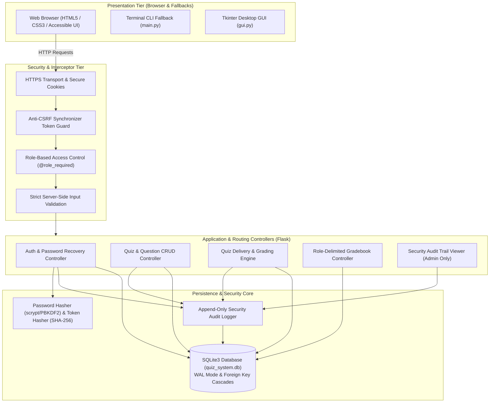

# Secure Online Quiz System (BBAT104 TQM Project)

[](https://www.python.org/)
[](https://www.sqlite.org/)
[](https://flask.palletsprojects.com/)
[](#academic-information)
[](#evaluation-milestones)
[](#assigned-quality-goal-q04--improve-security)

An enterprise-grade, secure Computer-Based Assessment (CBA) system built for the **BBAT104 – Fundamentals of Total Quality Management (TQM)** academic curriculum. The platform pairs complete assessment CRUD operations with comprehensive Defense-in-Depth application security controls under assigned Quality Goal **Q04 — Improve Security**.

---

## Academic Information

* **Course Code & Name:** BBAT104 – Fundamentals of Total Quality Management (TQM)
* **Academic Session:** 2026–2027
* **Candidate Roll Number:** 39
* **Candidate Name:** Krutika Agrawal
* **University Registration Number:** AU-24-5942
* **Assigned Baseline System:** **Digit 9** – Online Quiz System
* **Assigned Quality Goal:** **Q04 — Improve Security**
* **Core Objective:** Ensure secure quiz submissions, protect user data, and prevent unauthorized access
* **Project Repository:** `BBAT104_TQM_AU_24_5942`
* **Current Evaluation Scope:** Review 1 (Setup & SRS — 10 Marks) and Review 2 (Base System & CRUD — 15 Marks)

---

## Assigned Quality Goal: Q04 — Improve Security

In accordance with official BBAT104 project guidelines, Roll Number 39 maps to Baseline System 9 (Online Quiz System), with sequential allocation **Q04 — Improve Security**. The system implements all five designated security modules:

1. **Role-Based Login (RBAC):** Server-enforced role separation across **Administrator**, **Quiz Creator / Instructor**, and **Student** accounts, protected by `@role_required` decorators, session fixation defense, and Anti-CSRF synchronizer tokens.
2. **Password Reset:** Cryptographically randomized (32-byte URL-safe) single-use tokens stored as SHA-256 hashes with 15-minute expiration windows, rate limiting, and session revocation upon password update.
3. **Input Validation:** Multi-layered server-side type and bounds checking, parameterized SQLite queries to eliminate SQL injection, and Jinja2 contextual auto-escaping to prevent Cross-Site Scripting (XSS).
4. **Audit Trail:** Append-only security audit log (`audit_logs`) capturing authentication events, permission violations, password resets, and CRUD operations with timestamps, actor IDs, outcomes, and IP references.
5. **Encryption & Sensitive Data Protection:** Adaptive salted password hashing using Werkzeug/Python cryptographic primitives (PBKDF2/scrypt), environment-based secret key isolation (`FLASK_SECRET_KEY`), HTTPS-ready session cookie headers (`HttpOnly=True`, `SameSite=Lax`), and strict server-side quarantine of answer keys.

---

## Evaluation Milestones

| Milestone / Deliverable | Raw Marks | Status | Required Artefacts |
| :--- | :---: | :---: | :--- |
| **Review 1: Setup & SRS** | 10 Marks | **Complete** | GitHub Repository verification, [System Architecture Flowchart](docs/ARCHITECTURE.md), [SRS Document](docs/SRS.md), and [Scope Definition](docs/SCOPE.md). |
| **Review 2: Base System & CRUD** | 15 Marks | **Active** | Full CRUD for Quizzes and Questions; interactive student examination engine; 5 Q04 security features. |
| **Review 3: FMEA & Risk Audit** | 15 Marks | *Future Scope* | FMEA Matrix with RPN calculations, SIPOC Process Map, CTQ Tree, and Defect Logging checksheets. |
| **Review 4: SQC & Continuous Improvement**| 15 Marks | *Future Scope* | 80/20 Pareto Analysis, Ishikawa Fishbone Root-Cause Diagram, and PDCA Cycle tracking logs. |
| **Final Demo & Viva** | 10 Marks | *Future Scope* | Live application defense, security audit walkthrough, and oral viva. |
| **Documentation & GitHub Health** | 5 Marks | **Active** | Interactive README, $\ge 30$ meaningful Git commits, and clean version control sync. |

---

## Review 1 Deliverables Summary

The technical specifications governing the architecture and functional scope are maintained in `docs/`:

| Deliverable Document | Direct File Link | Primary Purpose & Key Coverage |
| :--- | :--- | :--- |
| **System Architecture Flowchart** | [`docs/ARCHITECTURE.md`](docs/ARCHITECTURE.md) | Multi-tier architecture, Mermaid flowcharts, authentication sequence diagrams, state transitions, ER schema, and security boundaries. |
| **Software Requirements Specification (SRS)** | [`docs/SRS.md`](docs/SRS.md) | IEEE 830-aligned specification with functional requirements (`FR-xx`), security requirements (`SEC-xx`), non-functional requirements (`NFR-xx`), and formal acceptance criteria. |
| **Scope Definition Document** | [`docs/SCOPE.md`](docs/SCOPE.md) | Exact project boundaries, Role-Based Access Control matrix, CRUD entity governance, explicit exclusions, and risk mitigations. |

---

## Repository Structure Map

```
BBAT104_TQM_AU_24_5942/
├── docs/
│   ├── ARCHITECTURE.md     # System Architecture & Technical Design Document
│   ├── SRS.md              # Software Requirements Specification (IEEE 830 Aligned)
│   └── SCOPE.md            # Project Scope Definition & Governance Matrix
├── static/
│   ├── css/
│   │   └── style.css       # Responsive styling, theme variables, and accessible components
│   └── js/
│       └── main.js         # Client-side countdown timer, autosave, and accessible UI helpers
├── templates/              # Jinja2 HTML5 templates
│   ├── base.html           # Shared master layout with navigation, flash alerts, and CSRF token
│   ├── index.html          # Quiz catalogue dashboard & portal landing
│   ├── quizzes.html        # Public quiz catalog list
│   ├── quiz_details.html   # Quiz metadata, duration, instructions, and start form
│   ├── quiz_question.html  # Interactive question viewer with timer and answer selection
│   ├── attempt_result.html # Session-private student scorecard
│   ├── login.html          # Secure role-based login form
│   ├── register.html       # Student self-registration form
│   ├── forgot_password.html# Password recovery request form
│   ├── reset_password.html # Password reset token verification and update form
│   ├── quiz_manage.html    # Instructor / Admin Quiz CRUD management panel
│   ├── question_manage.html# Instructor / Admin Question CRUD management panel
│   ├── results_manage.html # Role-delimited results & gradebook viewer
│   ├── audit_logs.html     # Administrator-only security audit trail viewer
│   └── placeholder.html    # Future review milestone placeholder view
├── tests/
│   ├── __init__.py
│   └── test_app.py         # Automated unit, CRUD, and security test suite
├── .gitignore              # Git exclusions (caches, virtualenvs, local databases)
├── app.py                  # Primary Flask WSGI web application controllers and routes
├── database.py             # SQLite persistence, schema migrations, and parameterized queries
├── gui.py                  # Preserved Tkinter desktop GUI application (fallback)
├── main.py                 # Preserved CLI runner and desktop launcher
├── quiz_system.db          # SQLite3 database (quizzes, questions, users, attempts, audit logs)
├── requirements.txt        # Production dependency specifications
└── README.md               # Main project manual, setup guide, and documentation
```

---

## System Architecture Flowchart



---

## Quickstart & Installation Guide

### Prerequisites
* **Python:** Python 3.10 or higher.
* **Git:** Version 2.30+.
* **Virtual Environment:** Python standard library `venv`.

### 1. Clone Repository & Environment Setup
```bash
# Clone the repository
git clone https://github.com/krutika-here/BBAT104_TQM_AU_24_5942.git
cd BBAT104_TQM_AU_24_5942

# Create and activate virtual environment
python3 -m venv .venv
source .venv/bin/activate  # On Windows: .venv\Scripts\activate

# Install required dependencies
pip install -r requirements.txt
```

### 2. Database Initialization
The database schema initializes automatically on first run. To manually verify or re-initialize:
```bash
python3 -c "import database; database.init_db(); print('Database verified successfully.')"
```

### 3. Launching the Web Application (Primary Interface)
```bash
# Run Flask web application
python3 app.py
```
Open your web browser and navigate to: **`http://127.0.0.1:5000`**

### 4. Launching the Preserved Fallback Interfaces
```bash
# Graphical Desktop Mode (requires X11/Tkinter)
python3 main.py

# Headless / Terminal CLI Mode
python3 main.py --cli
```

---

## Default User Roles & Credentials (Development / Evaluation)

For evaluation and testing purposes, the database is pre-seeded with initial accounts:

| Role | Username | Default Password | Access Scope |
| :--- | :--- | :--- | :--- |
| **Administrator** | `admin` | `Admin@1234` | Full access, user accounts, audit trail (`/audit-logs`) |
| **Instructor** | `instructor` | `Instructor@1234` | Quiz CRUD (`/quizzes/manage`), Question CRUD, Gradebook |
| **Student** | `student` | `Student@1234` | Catalog browsing, taking quizzes, private results |

> [!NOTE]
> In production hosting, default credentials must be rotated or overridden via environment variables. Passwords in the database are stored exclusively as salted hashes (`scrypt` / `pbkdf2:sha256`).

---

## Running the Automated Test Suite

The test suite validates route accessibility, CSRF protection, RBAC boundaries, CRUD operations, password reset token expiry, input bounds, and audit trail persistence:

```bash
# Run all unit and security tests
.venv/bin/python -m unittest discover -s tests -p "test_*.py" -v
```

---

## Deployment & Production Hosting Guidance

For production deployment on cloud platforms (e.g. Render, Railway, PythonAnywhere, AWS EC2):

1. **Set Environment Variables:**
   ```bash
   export FLASK_SECRET_KEY="replace-with-a-cryptographically-strong-random-hex-key"
   export FLASK_ENV="production"
   export PORT=5000
   ```
2. **Production WSGI Server:**
   Run using Gunicorn:
   ```bash
   gunicorn --bind 0.0.0.0:$PORT --workers 2 app:app
   ```
3. **HTTPS & Cookie Security:**
   When running behind an HTTPS reverse proxy (Nginx / Cloudflare / Render), cookies are transmitted with `Secure`, `HttpOnly`, and `SameSite=Lax`.
