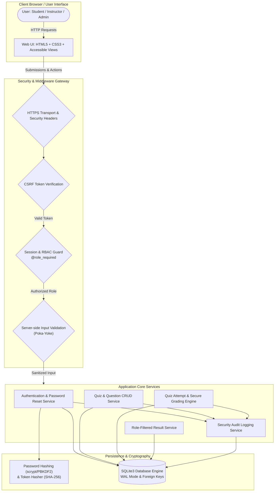
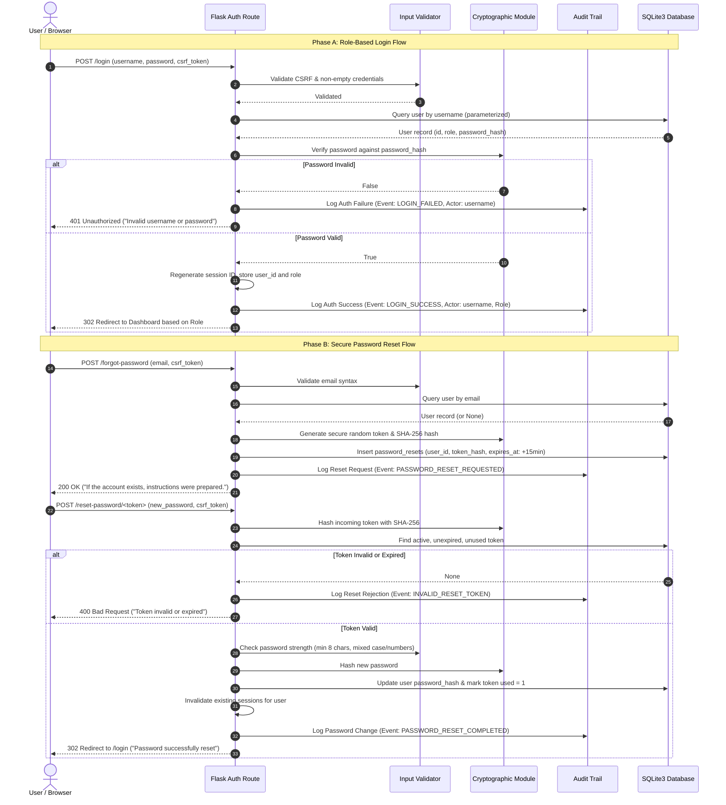
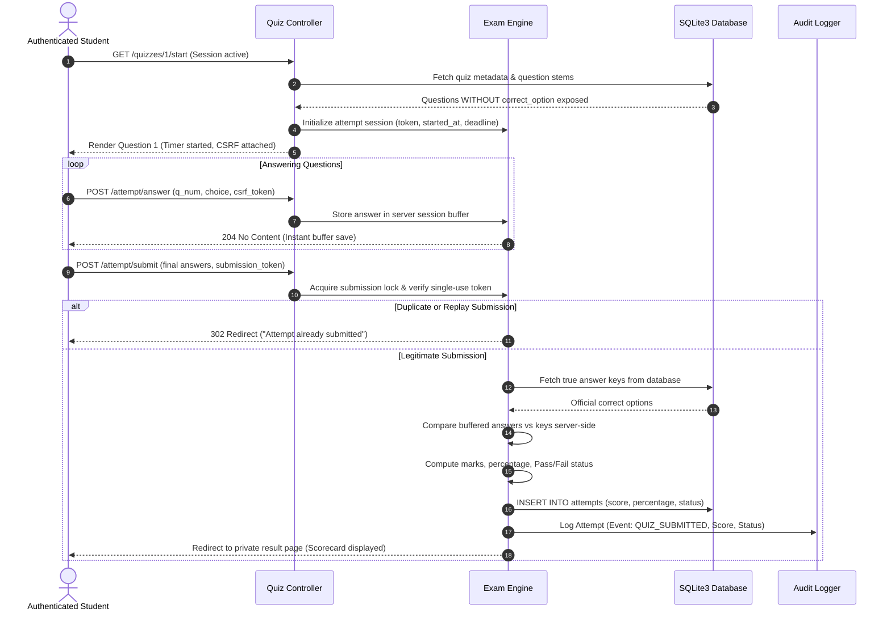
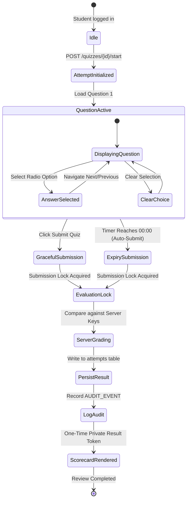
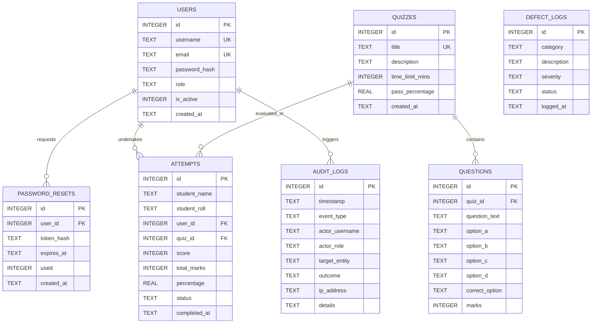

# System Architecture & Technical Design Document

**Project Title:** Secure Online Quiz System  
**Course Code & Name:** BBAT104 – Fundamentals of Total Quality Management (TQM)  
**Academic Session:** 2026–2027  
**Roll Number:** 39  
**Candidate Name:** Krutika Agrawal  
**Registration Number:** AU-24-5942  
**Assigned Topic Digit:** 9 – Online Quiz System  
**Assigned Quality Goal:** Q04 — Improve Security  
**Core Objective:** Ensure secure quiz submissions, protect user data, and prevent unauthorized access  
**Evaluation Scope:** Review 1 (Setup & SRS) and Review 2 (Base System & CRUD)  
**Document Revision:** 2.0 (Security Engineering Architecture)  

---

## 1. Executive Summary & Architectural Vision

The **Secure Online Quiz System** is an enterprise-grade academic assessment platform engineered according to the principles of Total Quality Management (TQM) and Defense-in-Depth application security. Modern Computer-Based Assessment (CBA) systems routinely face severe security risks, including unauthorized administrative privilege escalation, student session tampering, answer-key leakage in client responses, credential stuffing, SQL injection, Cross-Site Scripting (XSS), and Cross-Site Request Forgery (CSRF).

Under the assigned TQM Quality Goal **Q04 — Improve Security**, this system implements five foundational security controls directly integrated into a modular web architecture:
1. **Role-Based Login & Authorization (RBAC):** Cryptographically enforced separation of privileges across three roles: *Administrator*, *Quiz Creator / Instructor*, and *Student*.
2. **Secure Password Reset:** Cryptographically randomized, single-use, time-delimited (15-minute) reset tokens stored as SHA-256 hashes, with session invalidation upon credential update.
3. **Comprehensive Input Validation:** Multi-layered server-side boundary checks, type casting, whitelist filtering, contextual HTML escaping, and parameterized SQL queries to eliminate injection flaws.
4. **Tamper-Evident Security Audit Trail:** An append-only audit log tracking every authentication event, permission failure, administrative action, and CRUD mutation with timestamps, actors, and network context.
5. **Encryption & Sensitive Data Protection:** Modern, adaptive password hashing (PBKDF2-HMAC-SHA256 / scrypt via Werkzeug/hashlib), secure HTTP cookies (`HttpOnly`, `SameSite=Lax`, `Secure`), runtime secret key isolation outside source control, and zero exposure of answer keys prior to evaluation.

In addition to the primary browser-based web architecture, the system preserves existing desktop (Tkinter) and terminal CLI modules as robust local execution fallbacks.

---

## 2. System Architecture Decomposition

The system is organized into a modular four-tier architecture with explicit trust boundaries:

```
+─────────────────────────────────────────────────────────────────────────────+
|                         TIER 1: PRESENTATION TIER                           |
|  +───────────────────────────────────+  +────────────────────────────────+  |
|  | Web Browser Interface (HTML5/CSS3)|  | Preserved Execution Fallbacks  |  |
|  | - Student Quiz Portal & Timer     |  | - Tkinter Desktop GUI (gui.py) |  |
|  | - Instructor Quiz & Question CRUD |  | - Terminal CLI Runner (main.py)|  |
|  | - Admin RBAC & Audit Trail Viewer |  |                                |  |
|  | - Secure Auth & Password Recovery |  |                                |  |
|  +───────────────────────────────────+  +────────────────────────────────+  |
+──────────────────────────────────────┬──────────────────────────────────────+
                                       │ HTTPS / TLS (Encrypted Transport)
+──────────────────────────────────────▼──────────────────────────────────────+
|              TIER 2: APPLICATION & ACCESS CONTROL TIER (Flask WSGI)         |
|  +───────────────────────────────────────────────────────────────────────+  |
|  | Request Interceptor & Security Middleware                             |  |
|  | - HTTPS Enforcement & Secure Cookie Headers                           |  |
|  | - Anti-CSRF Token Generation & Synchronizer Token Validation          |  |
|  | - Session Fixation Defense & Session Regeneration                     |  |
|  +───────────────────────────────────────────────────────────────────────+  |
|  +───────────────────────────────────────────────────────────────────────+  |
|  | Authentication & Role-Based Access Control (RBAC Engine)               |  |
|  | - @login_required & @role_required('admin', 'instructor', 'student')   |  |
|  | - Privilege Escalation Prevention & IDOR Boundary Verification        |  |
|  +───────────────────────────────────────────────────────────────────────+  |
|  +───────────────────────────────────────────────────────────────────────+  |
|  | Core Functional Controllers (Blueprints / Endpoints)                  |  |
|  | - Auth Controller: Login, Register, Logout, Password Reset Token      |  |
|  | - Quiz & Question CRUD Controller: Create, Read, Update, Delete Quizzes|  |
|  | - Examination & Grading Engine: Deadline checks, In-memory evaluation |  |
|  | - Result & Gradebook Controller: Role-delimited score history        |  |
|  | - Security Audit Viewer: Paginated, read-only event logs (Admin only) |  |
|  +───────────────────────────────────────────────────────────────────────+  |
+──────────────────────────────────────┬──────────────────────────────────────+
                                       │ Strict Validation & Parameterization
+──────────────────────────────────────▼──────────────────────────────────────+
|                       TIER 3: BUSINESS & SECURITY DOMAIN                    |
|  +─────────────────────────+  +────────────────────────+  +──────────────+  |
|  | Input Validation Engine |  | Cryptographic Engine   |  | Audit Logger |  |
|  | - Whitelist validators  |  | - Password Hashing     |  | - Auth logs  |  |
|  | - Range & format checks |  | - Reset Token Gen/Hash |  | - CRUD logs  |  |
|  | - Poka-Yoke error gates |  | - Secret Isolation     |  | - Alert logs |  |
|  +─────────────────────────+  +────────────────────────+  +──────────────+  |
+──────────────────────────────────────┬──────────────────────────────────────+
                                       │ Parameterized SQL Queries (ACID)
+──────────────────────────────────────▼──────────────────────────────────────+
|                       TIER 4: PERSISTENCE LAYER                             |
|  +───────────────────────────────────────────────────────────────────────+  |
|  | SQLite3 Relational Database (quiz_system.db with WAL mode)             |  |
|  | - users (id, username, email, password_hash, role, created_at, active)|  |
|  | - password_resets (id, user_id, token_hash, expires_at, used)         |  |
|  | - quizzes (id, title, description, time_limit_mins, pass_percentage)  |  |
|  | - questions (id, quiz_id, text, opt_a..opt_d, correct_option, marks)   |  |
|  | - attempts (id, student_id, quiz_id, score, total_marks, %, status)   |  |
|  | - audit_logs (id, timestamp, event_type, actor, target, outcome, ctx) |  |
|  | - defect_logs (TQM checksheet defect tracking)                         |  |
|  +───────────────────────────────────────────────────────────────────────+  |
+─────────────────────────────────────────────────────────────────────────────+
```

---

## 3. Visual System Flowcharts

### 3.1 High-Level Architecture Flowchart



---

### 3.2 Authentication & Password Reset Sequence Diagram



---

### 3.3 Quiz Attempt, Answer Protection & Grading Sequence Diagram



---

### 3.4 State Transition Diagram for Quiz Attempt Lifecycle



---

## 4. Role-Based Access Control (RBAC) Architecture

### 4.1 Permission Matrix

| Capability / Endpoint | Anonymous | Student | Quiz Creator / Instructor | Administrator |
| :--- | :---: | :---: | :---: | :---: |
| View Homepage & Public Catalog | **Yes** | **Yes** | **Yes** | **Yes** |
| Register Account (Student default) | **Yes** | No | No | No |
| Login / Logout / Request Reset | **Yes** | **Yes** | **Yes** | **Yes** |
| Start & Submit Quiz Attempt | No | **Yes** | **Yes** | **Yes** |
| View Personal Quiz Scorecard | No | **Yes** (Own only) | **Yes** (Own only) | **Yes** (Own only) |
| View Personal Result History | No | **Yes** (Own only) | **Yes** (Own only) | **Yes** (Own only) |
| View Global Student Gradebook | No | No | **Yes** (All students) | **Yes** (All students) |
| Create New Quiz (Quiz CRUD) | No | No | **Yes** | **Yes** |
| Edit / Update Quiz Metadata | No | No | **Yes** | **Yes** |
| Delete Quiz (Cascade Questions) | No | No | **Yes** | **Yes** |
| Add Questions to Quiz (Q CRUD) | No | No | **Yes** | **Yes** |
| Edit Question & Options | No | No | **Yes** | **Yes** |
| Delete Question from Quiz | No | No | **Yes** | **Yes** |
| View Security Audit Trail | No | No | No | **Yes** (Exclusive) |
| View TQM Defect Log Checksheet | No | No | **Yes** | **Yes** |
| Manage User Roles / Accounts | No | No | No | **Yes** (Exclusive) |

### 4.2 Server-Side Authorization Enforcement
Authorization is strictly enforced in Python route decorators:
- `@login_required`: Verifies presence and authenticity of active user session.
- `@role_required(['admin', 'instructor'])`: Checks session role against allowed role whitelist. If an unauthenticated user accesses the route, they are redirected to `/login`. If an authenticated user lacks permissions, the server responds with a strict `403 Forbidden` and logs an `UNAUTHORIZED_ACCESS_ATTEMPT` audit event.

---

## 5. Database Schema & Data Dictionary

The persistence tier utilizes SQLite3 configured with Write-Ahead Logging (`PRAGMA journal_mode=WAL`) and foreign key enforcement (`PRAGMA foreign_keys=ON`).

### 5.1 Entity-Relationship (ER) Diagram



### 5.2 Schema Specification & Security Attributes

#### 1. Table: `users`
- `id` (INTEGER PRIMARY KEY AUTOINCREMENT)
- `username` (TEXT NOT NULL UNIQUE COLLATE NOCASE)
- `email` (TEXT NOT NULL UNIQUE COLLATE NOCASE)
- `password_hash` (TEXT NOT NULL) — Salted, cryptographic hash (e.g. `scrypt:32768:8:1` or `pbkdf2:sha256`)
- `role` (TEXT NOT NULL DEFAULT 'student') — Whitelist: `'admin'`, `'instructor'`, `'student'`
- `is_active` (INTEGER NOT NULL DEFAULT 1) — Account status flag
- `created_at` (TEXT DEFAULT CURRENT_TIMESTAMP)

#### 2. Table: `password_resets`
- `id` (INTEGER PRIMARY KEY AUTOINCREMENT)
- `user_id` (INTEGER NOT NULL, FK to `users.id` ON DELETE CASCADE)
- `token_hash` (TEXT NOT NULL UNIQUE) — SHA-256 hash of token; raw token is never persisted
- `expires_at` (TEXT NOT NULL) — ISO 8601 timestamp (+15 minutes limit)
- `used` (INTEGER NOT NULL DEFAULT 0) — Flag enforced for single-use consumption
- `created_at` (TEXT DEFAULT CURRENT_TIMESTAMP)

#### 3. Table: `quizzes`
- `id` (INTEGER PRIMARY KEY AUTOINCREMENT)
- `title` (TEXT NOT NULL UNIQUE)
- `description` (TEXT)
- `time_limit_mins` (INTEGER DEFAULT 10)
- `pass_percentage` (REAL DEFAULT 50.0)
- `created_at` (TEXT DEFAULT CURRENT_TIMESTAMP)

#### 4. Table: `questions`
- `id` (INTEGER PRIMARY KEY AUTOINCREMENT)
- `quiz_id` (INTEGER NOT NULL, FK to `quizzes.id` ON DELETE CASCADE)
- `question_text` (TEXT NOT NULL)
- `option_a` (TEXT NOT NULL)
- `option_b` (TEXT NOT NULL)
- `option_c` (TEXT NOT NULL)
- `option_d` (TEXT NOT NULL)
- `correct_option` (TEXT NOT NULL CHECK(correct_option IN ('A','B','C','D')))
- `marks` (INTEGER DEFAULT 1 CHECK(marks >= 1))

#### 5. Table: `attempts`
- `id` (INTEGER PRIMARY KEY AUTOINCREMENT)
- `student_name` (TEXT NOT NULL)
- `student_roll` (TEXT NOT NULL)
- `user_id` (INTEGER, FK to `users.id`)
- `quiz_id` (INTEGER NOT NULL, FK to `quizzes.id`)
- `score` (INTEGER NOT NULL)
- `total_marks` (INTEGER NOT NULL)
- `percentage` (REAL NOT NULL)
- `status` (TEXT NOT NULL CHECK(status IN ('Passed', 'Failed')))
- `completed_at` (TEXT DEFAULT CURRENT_TIMESTAMP)

#### 6. Table: `audit_logs`
- `id` (INTEGER PRIMARY KEY AUTOINCREMENT)
- `timestamp` (TEXT DEFAULT CURRENT_TIMESTAMP)
- `event_type` (TEXT NOT NULL) — e.g. `AUTH_LOGIN_SUCCESS`, `AUTH_LOGIN_FAILURE`, `AUTH_LOGOUT`, `PASSWORD_RESET_REQ`, `PASSWORD_RESET_DONE`, `QUIZ_CREATE`, `QUIZ_UPDATE`, `QUIZ_DELETE`, `QUESTION_CREATE`, `QUESTION_UPDATE`, `QUESTION_DELETE`, `UNAUTHORIZED_ACCESS`
- `actor_username` (TEXT NOT NULL)
- `actor_role` (TEXT NOT NULL)
- `target_entity` (TEXT) — e.g. `quiz:1`, `question:5`, `user:admin`
- `outcome` (TEXT NOT NULL) — `SUCCESS`, `FAILURE`, `BLOCKED`
- `ip_address` (TEXT) — Client remote IP
- `details` (TEXT) — Contextual message (never logging plaintext passwords or raw tokens)

#### 7. Table: `defect_logs`
- Preserved for TQM quality checksheet and SQC defect tracking.

---

## 6. Software Architecture Quality Attributes

| Quality Attribute | Architectural Strategy | Verification Mechanism |
| :--- | :--- | :--- |
| **Security (Confidentiality)** | Answer keys stripped from client DOM; password hashes using salted scrypt/PBKDF2; session cookies HttpOnly and SameSite. | Automated DOM inspection tests; code review of API contracts. |
| **Security (Integrity)** | CSRF synchronizer tokens on all state-changing endpoints; foreign key cascading; single-use submission locks. | Penetration unit tests for replay attacks and CSRF omission. |
| **Security (Accountability)** | Dedicated audit trail recording all security-relevant transactions with timestamps and actors. | Unit tests asserting audit records generated upon login, CRUD, and access violations. |
| **Reliability & ACID** | Parameterized SQLite queries with WAL journaling; automatic rollback on error. | Concurrent transaction tests; database integrity checks. |
| **Usability & Poka-Yoke** | Server-side validation with clear user-friendly notifications; debounce locks preventing double submission. | Form validation testing with invalid/empty payloads. |
| **Portability** | Cross-platform Python 3.10+ execution; preserved Tkinter GUI and CLI harness; zero bloated external dependencies. | Multi-environment validation on Linux/macOS/Windows. |

---

## 7. Review 1 Approval & Sign-Off

| Milestone Deliverable | Verification Status | Document Revision | Approval Date |
| :--- | :---: | :---: | :---: |
| **System Architecture Flowchart** | Verified & Formatted | 2.0 (Security Architecture) | October 2026 |
| **Software Requirements Specification (SRS)** | Aligned with Q04 Security | 2.0 (Security Engineering) | October 2026 |
| **Scope Definition Document** | Aligned with Reviews 1 & 2 | 2.0 (Formal Scope) | October 2026 |
| **Repository Initialization & Structure** | Initialized, verified, in sync | 20+ Git Commits | October 2026 |
